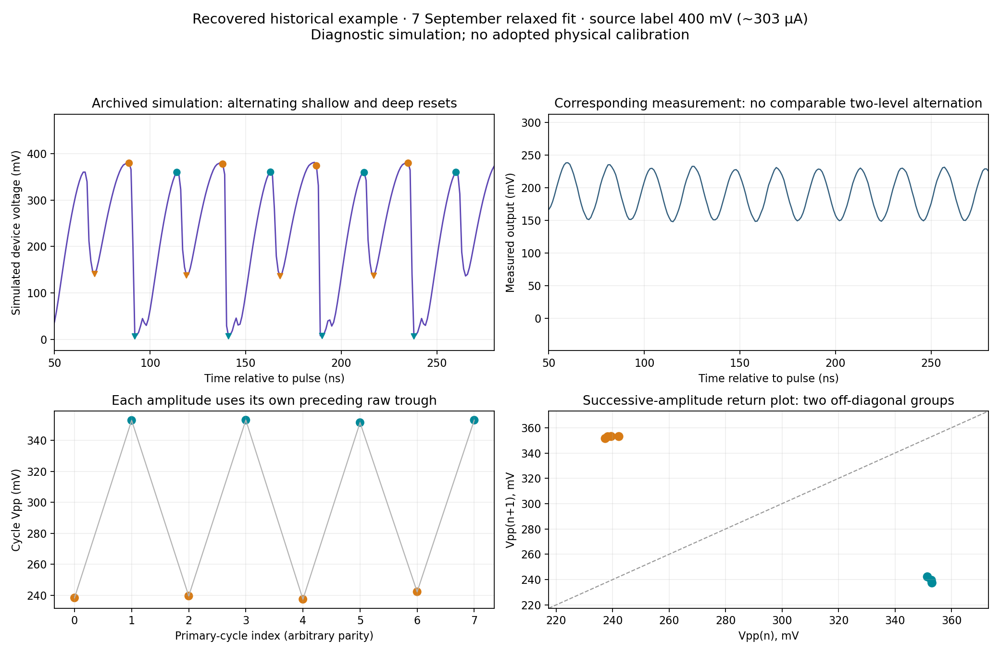
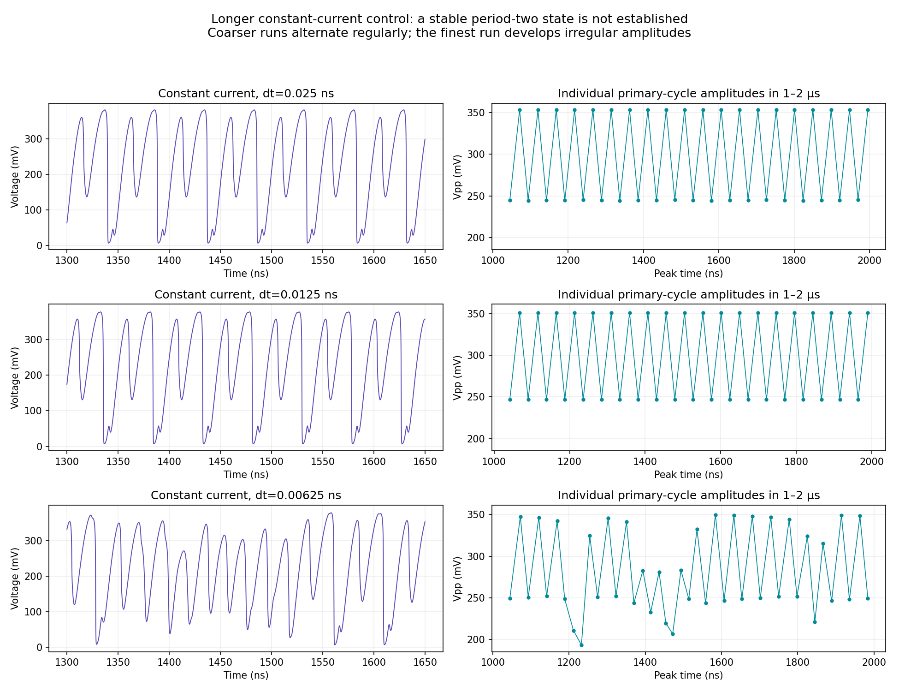

# Alternating oscillation amplitudes — recovered 25 October 2026

[Open the illustrated finding and interactive replays](../public_jobs/20261025_082439_documented-alternating-amplitude-historical-simu_1072ef/index.html)
or [read the full audit](../public_jobs/20261025_082439_documented-alternating-amplitude-historical-simu_1072ef/report.md).

The exact vector is now saved in
`presets/alternating_amplitude_relaxed_20260907.json`.
[Open the classic 44-GIF current sweep](../public_jobs/20261025_091004_fixed-alternating-amplitude-classic-gifs_4b9e8c/START_HERE.html):
22 measured-current records at 0.025 and 0.00625 ns, with current above simulated
voltage above native R(T). A third timestep is retained numerically. Original
0.025 ns samples match the historical outputs within 1.53e-11 mV. Middle panels
show only simulated voltage, as requested. The same frozen vector drives all inputs.

The presentation's final slide (22) shows the alternating resets and native
shallow/deep R(T) cycles. It gives **tau_th=Cth/Se=11.9087 ns** and
**tau_e=CR(T,H)=0.1334–11.9846 ns** along the central 50–280 ns replay, with
the fully metallic limit **CRm=0.1245 ns**. Shallow cycles reach about 338 K
(minimum R about 120 ohm), deep cycles about 348 K (minimum R about 20 ohm).
Comparable recharge/recovery times and different hysteresis histories support
a working electrothermal-memory explanation. Passive cooling and frozen-R
RC scales alone do not prove the cause or predict the full coupled period.

## Where it was found

The clear example is in the **7 September relaxed simulation**:
`20260907_125315_physics-anchored-specimen-waveform-inference_717797`,
`fitted_traces.csv`, `fit_mode=relaxed`, `source_file=400mv0_converted.csv`,
column `predicted_voltage_mV`. The 350 and 450 mV source labels show related
behavior. These are filename/source labels, not currents in µA.

This is the original 100425 specimen model, **not the later M2 sample**.
The corresponding measured output does not show comparable amplitude alternation.

## The observation

Between 50 and 280 ns, eight primary cycles alternate between approximately
**238.92 and 352.98 mV Vpp**. The feature is especially clear in the troughs:
successive resets are shallow, deep, shallow, deep. Peak heights alone differ
much less. Adjacent-cycle amplitudes have correlation −0.99939; amplitudes two
cycles apart have correlation +0.99924. A median amplitude would hide the pattern.



The primary-peak spacing is about 24.5 ns; a pair repeats in about 49 ns.
Thus counting individual peaks and counting complete large/small pairs give
different descriptive rates. This does not imply two independent oscillators.

## What the checks support

- The native replay at the archived 0.025 ns timestep reproduces saved voltages
  within 1.53×10⁻¹¹ mV maximum sampled difference.
- The original measured-input 50–280 ns window retains alternation at 0.0125
  and 0.00625 ns. All 16 combinations of primary-peak prominence and smoothing
  checked at each timestep retain the qualitative finding.
- A constant-current control uses **303.391147 µA**, the median archived,
  baseline-corrected input over 150–250 ns, and extends to 2 µs. The last 1 µs
  alternates regularly at 0.025 and 0.0125 ns but becomes irregular at 0.00625 ns.



The appropriate documented claim is **alternating-amplitude oscillations in a
historical diagnostic simulation**. A stable long-time period-two attractor,
a period-doubling bifurcation, chaos, and experimental period doubling are
**not established**. The short-window pattern survives refinement; the final
long-time state is not converged by these checks.

## Settings and reproducibility

C=6.835494476 pF; Cth=0.04421419302 pJ/K; Se=0.003712762043 mW/K;
T0=Tinit=314.363069806 K; Tc=333.338417242 K; w=7.041456088 K;
beta=0.3144377018 /K; gamma=0.1569637099; Vinit=0; insulating initial branch.
Other resistance parameters use `presets/resistance_100425_chip1_gap3.json`.
C and gamma lie outside that historical fit's configured constrained intervals;
those intervals are not universal laws. No fit or physical calibration is adopted.

The reusable control recipe is
`experiments/current/alternating_amplitude_reference_20261025.toml`:

```bash
neuristor simulate current --config experiments/current/alternating_amplitude_reference_20261025.toml
```

The archived finding includes a portable copy, the exact standard CLI run,
18 native replays (three source labels × two input modes × three timesteps),
original numerical inputs, per-cycle measurements, detection-sensitivity tables,
parameter provenance and frozen package source. Analysis scripts preserve their
original repository-relative `runs/double_oscillation_20261025/` working layout;
the portable TOML control can run directly from the evidence bundle.

Primary-cycle amplitudes are each raw peak minus its own preceding raw trough.
Smoothing only locates primary peaks; the report gives thresholds and synthetic
controls. The original 3%-prominence discovery search also detects small reset
shoulders and is not used for the final primary-cycle claim.
200 repository tests, repository validation, the exact recipe, synthetic signal
checks, input hashes and artifact-link checks pass. Figures were visually
inspected. No browser interaction or GitHub upload is claimed.
