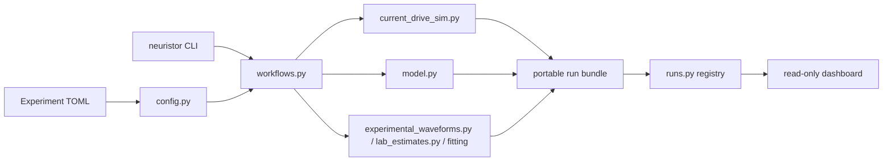

# Architecture

The codebase separates scientific truth, orchestration, and presentation so terminal
commands and the dashboard cannot drift into different models.

## Layer responsibilities

### Physics

`model.py` and `current_drive_sim.py` integrate the equations and own hysteresis
state. They do not know about TOML, Typer, Streamlit, Git, or output directories.

### Analysis

Waveform import, fitting, and laboratory estimate modules operate on numerical arrays
or data frames. They expose reusable functions rather than command-line parsing. Plot
pixels are not a supported data source.

### Workflow

`workflows.py` resolves presets, converts named user units to SI, calls one scientific
function, produces canonical metrics and plots, and completes or fails a `RunBundle`.
Sweep points call the same single-run evaluator, preventing a separate sweep model.

The stable API remains in `workflows.py`. `map_workflows.py` isolates cohesive
screened-map/media orchestration; `sample_study.py` coordinates fit → grid → GIFs
through the established workflow calls. Neither duplicates physics or unit
conversion. Child evidence lives together in the parent study's `stages/` folder;
only the parent is a top-level registry record. See [the module map](CODEBASE_MAP.md).

`artifact_catalog.py` provides a generated HTML/CSV navigation hub, not another
database or copy of the media. New sample studies embed GIFs in one shareable
HTML without a ZIP; the complete folder retains raw data and original GIFs.

### Interface

`cli.py` parses terminal arguments and reports output paths. `dashboard.py` reads
existing records through `RunRegistry`. The dashboard cannot create a simulation;
this is a deliberate reproducibility boundary.

`interfaces/run_manager.py` is the separate loopback-only artifact manager.
It authorizes confirmed trash/restore operations through `RunRegistry`; it never
changes published evidence, physical equations, or active jobs. The exported
HTML remains read-only; session tokens are injected into the served page only.
See [the management guide](RUN_MANAGEMENT.md).

## Compatibility boundary

Implementation modules are grouped under `analysis/`, `fitting/`, `plotting/`,
`orchestration/`, `interfaces/`, and `legacy/`. The authoritative physics and public
workflow paths stay unchanged. Old-name modules alias their grouped module object;
there is no second implementation. See [the source guide](CODEBASE_MAP.md).
Run source snapshots now recurse through the complete package. Reused numerical
evidence retains its original source separately from the current viewer's source.

The dashboard registry normalizes two on-disk formats:

- new `run.json` bundles under `runs/local/` and `runs/published/`;
- historical `job.json` directories under `runs/legacy/` and `runs/published/`.

This lets the UI improve without rewriting historical evidence. The old simulation
UI and one-off scripts remain recoverable at `v0.1.0-working-baseline`.

## Failure behavior

A workflow creates its manifest with status `running`. On success it registers every
artifact and changes status to `completed`. If orchestration raises an exception, it
records the exception type and message and marks the bundle `failed` before
re-raising. This makes interrupted work visible without mistaking it for evidence.
