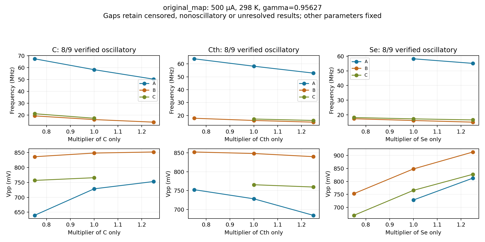
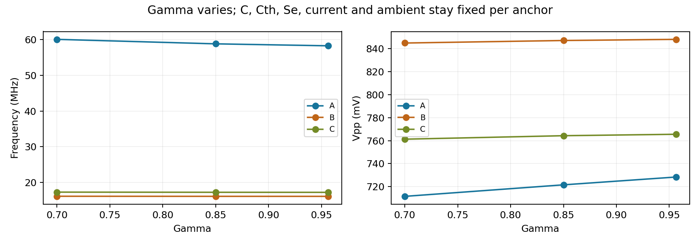

# Fresh validation of parameter trends — 20–21 October 2026

## Results: what survived the fresh checks

The common-capacitance timing trend is confirmed in these controlled simulations.
The individual frequency tendencies also hold in all 15 usable one-parameter
comparisons at the original map conditions. The earlier amplitude wording needs
qualification: the capacitance effects are often too small to resolve, while
the Se effect is clearer. These are conditional model results, not fitted
specimen values or a match to the experimental sweep.

The study covers **75 distinct physical parameter/operating settings**, arranged
into **108 logical comparison cases** with repeated centers. There are **610
distinct integrations** across timesteps and observation horizons: 466 in the
initial pass and 144 additional integrations in the longer-window follow-up.

### 1. Scaling both capacitances changes timing, not the state path

For constant ideal current and the stated deterministic model,

\[
(C,C_{th})\mapsto(sC,sC_{th}),\qquad
f\mapsto f/s,\qquad V_{pp}\mapsto V_{pp}.
\]

All **12/12 final scale comparisons** have verified oscillatory endpoints and
pass the unchanged 2% frequency/amplitude test. Each endpoint passes the
successive-horizon checks and the last-three-timestep checks.

| Numerical protocol | Verified scale pairs | Maximum final frequency scaling error | Maximum extracted Vpp change |
|---|---:|---:|---:|
| Fixed physical timestep, refined | 6/6 | 0.3443% | 0.8608% |
| Timestep scaled with capacitances | 6/6 | 0% | 0.8706% |

With co-scaled timestep, corresponding saved voltage, temperature **and
resistance** samples match exactly. The small reported Vpp changes arise from
feature extraction with a fixed physical-time smoother/locator; they do not
represent a change in the simulated state path. Frequency from the separate
rising-crossing measurement agrees with the peak-based measurement within
**0.0034%** on the final verified comparisons. Its maximum scaling error is
0.3446% for fixed dt and 0% for co-scaled dt.

This validates the clock/feature trend, not full pointwise waveform convergence
at fixed physical dt. Unaligned sampled-path differences can be large even when
frequency and amplitude agree: across the saved fixed-dt checks, the maximum
voltage RMSE is 39.36% of the reference span and temperature RMSE is 11.13 K.
No phase alignment was used to conceal these differences. Co-scaled paths have
zero sampled-path error; that preserves the discretization and is distinct from
proving accuracy of the continuum waveform.

### 2. Individual parameter tendencies are conditional

These counts apply to **500 µA, 298 K, gamma=0.956269682**, with one parameter
varied and the other two held fixed at each of three prespecified anchors.
Only pairs whose two endpoints pass both persistence and timestep checks count.
A direction must exceed 2% and twice the larger endpoint's timestep change.

| Parameter increased | Usable pairs / prescribed pairs | Frequency result | Resolved Vpp result |
|---|---:|---|---|
| C | 5/6 | Decreases in all 5 | Increases in 2; 3 changes too small to resolve |
| Cth | 5/6 | Decreases in all 5 | Decreases in 2; 3 changes too small to resolve |
| Se | 5/6 | Decreases in all 5 | Increases in all 5 |

The three unavailable comparisons are informative: anchor A at 0.75 times Se
is verified nonoscillatory; anchor C at 1.25 times C and at 0.75 times Cth leaves
the measured resistance-temperature interval. The latter two are censored
extrapolations, not demonstrated physical nonoscillation boundaries.



For anchor A, increasing one quantity by 25% relative to its center gives:

| Change | Frequency change | Vpp change |
|---|---:|---:|
| C × 1.25 | -13.75% | +3.36% |
| Cth × 1.25 | -9.17% | -6.00% |
| Se × 1.25 | -5.37% | +11.58% |

Thus a shared capacitance scale can tune frequency without repairing an
amplitude mismatch. The ratio and Se affect waveform size; reducing Se can
also end oscillation. These statements do not imply a globally monotonic law
or uniquely identifiable specimen parameters.

### 3. Gamma is a weaker feature control in these examples

All nine gamma cases are verified oscillators. Over gamma=0.70 to 0.956269682:

| Anchor | Frequency change | Vpp change |
|---|---:|---:|
| A | -3.00% | +2.36% |
| B | -0.18% | +0.38% |
| C | -0.36% | +0.56% |

Five of six adjacent frequency changes and all six adjacent amplitude changes
fall below the direction-resolution rule. The table's full-range changes are
descriptive. It does **not** establish that gamma is unimportant in other
parameter regimes or outside this tested interval.



### 4. Operating conditions and numerical limits matter

| Local-sweep condition | Oscillatory logical cases | Nonoscillatory | Temperature-censored | Inconclusive |
|---|---:|---:|---:|---:|
| 500 µA, 298 K | 24/27 | 1 | 2 | 0 |
| 350 µA, 298 K | 2/27 | 6 | 0 | 19 |
| 500 µA, 314.4 K | 6/27 | 4 | 0 | 17 |

Repeated centers make these case counts correlated. At the lower current and
warmer ambient, **none of the 18 prescribed adjacent pairs per condition** has
two verified oscillatory endpoints. The same one-parameter trends are therefore
**not established there**. Inconclusive does not mean physically nonoscillatory.

Short windows were a real limitation: at the initial 600 ns horizon, the quarter-
width windows contain too few complete cycles for the slower anchors. Their
1200 and 2400 ns results agree. Missing frequency must remain distinct from
zero frequency or proved absence of oscillation. One half-scale C case also
crossed the temperature boundary only at the coarsest dt; three smaller steps
resolve it inside the domain. Neither a short window nor coarse overshoot is
sufficient evidence of a physical boundary.

The old map's display box is also not a physical limit. Verified co-scaled
examples include C=21.01 pF and 24.68 pF (both beyond the old 20 pF axis), with
frequencies 8.06 and 8.62 MHz and approximately unchanged Vpp. The half-scale A
case remains oscillatory at 116.45 MHz, beyond the old 110 MHz operating screen.
These are conditional extensions of the scale ray, not a complete new boundary
search or an experimentally calibrated parameter range.

The useful separation is **waveform shape versus clock scale**. It applies to
the constant-current deterministic model and comparable observation times.
A fixed-duration measured input waveform must still be replayed explicitly;
these tests do not repair or validate the earlier quantitative experimental fit.


## Prespecified experiment

This follows the saved-data review in
[PARAMETER_EXPLORATION_TRENDS_20261020](PARAMETER_EXPLORATION_TRENDS_20261020.md).
The following design was fixed before the new recipe was run. The original
19-slide presentation and completed map bundles remain unchanged.

1. Derive the common-capacitance identity from the deterministic equations;
   test three previously oscillating anchors, capacitance factors 0.5, 1 and 2,
   with both fixed physical dt and dt scaled by the same factor. Scale the
   observation horizon in both protocols so finite startup time is comparable.
2. For each anchor, vary C, Cth and Se separately by factors 0.75, 1 and 1.25.
   Test the original 500 µA / 298 K conditions, 350 µA / 298 K, and
   500 µA / 314.4 K. Current is an imposed operating condition, not a parameter.
3. At the original conditions, vary gamma over 0.70, 0.85 and 0.956269682,
   holding the electrical and thermal quantities fixed at each anchor.

The anchors were selected before the new experiment from existing oscillating
examples, not optimized using the new outcomes:

| Anchor | C (pF) | Cth (pJ/K) | Se (µW/K) |
|---|---:|---:|---:|
| A | 3.0000 | 0.072000 | 6.0000 |
| B | 10.5061 | 0.223607 | 8.1072 |
| C | 12.3407 | 0.162066 | 5.9241 |

Every case uses nominal dt 0.0125, 0.00625 and 0.003125 ns. One further halving
is available only for unresolved timestep results. Require 2% feature agreement
across the last three steps. Simulate nominal horizons of 600 and 1200 ns,
with two adjacent late windows at each horizon and agreement between horizons.
Common-scale cases multiply both horizons by their scale factor. All starts
use V=0, T=T0 and the insulating branch. No phase alignment is used.

The static fit and supported float32 hysteresis are unchanged. Temperature is
screened against the measured 289.8545–370.1625 K interval, stricter than the old
map's padding. No frequency ceiling suppresses oscillators. Missing cycles,
censored paths and unresolved points remain in the result tables.

The 108 logical cases deliberately repeat center points across comparisons;
identical integrations share a cache. Counts of cases, unique integrations,
verified pairs and exceptions will be reported separately after completion.
Features here use native solver timestamps and the existing nominal 0.5 ns
extrema smoothing. Earlier measured-waveform fitting resampled simulations onto
the 1 ns acquisition grid, where the minimum five-sample smoother spans five
samples. This study does not repeat that experimental loss pipeline. Numerical
map amplitudes therefore should not be treated as directly comparable measured
amplitudes without matching acquisition and feature extraction.

Plots show only verified oscillators and retain gaps. A direction must exceed
2% and twice the larger endpoint's last-three-step change to receive a label;
that numerical envelope is not a confidence interval.

## Reproduction

```bash
neuristor analyze validate-trends --config experiments/current/validate_parameter_trends_20261020.toml
```

The recipe is versioned. Each run saves its case plan, SI parameters, exact source,
all integrations, classifications, timestep/horizon checks, comparison tables,
sampled scaling paths and figures. No fitting or parameter selection is performed.

## Why the common-scale prediction holds

For constant imposed current and noise-free equations,

C dV/dt = I - V/R(T,H),
Cth dT/dt = V²/R(T,H) - Se(T-T0).

Let V_s(t)=V(t/s), T_s(t)=T(t/s), and follow the same temperature path in the
hysteresis memory. Their derivatives carry a factor 1/s. Multiplying both C
and Cth by s therefore preserves both equations and the initial state. Period
multiplies by s; Vpp and the state path stay unchanged. This requires no
independent memory clock and does not apply unchanged to a fixed-duration pulse
or a measured input waveform whose time axis is held fixed.

Co-scaled dt tests covariance of the discrete solver. Fixed physical dt followed
by refinement independently checks numerical accuracy. The fixed physical-time
feature-smoothing width can slightly change measured extrema under time scaling;
raw sampled-state-path errors are recorded separately. Path errors use 2,048
interpolated samples across the entire history, no phase alignment, and are not
maximum-error bounds between samples. Results remain conditional model evidence,
not a new specimen calibration or universal monotonicity claim.

## Observation-window follow-up

Preliminary integrations show that anchors B and C lack enough cycles in the
600 ns horizon's quarter-width late windows, while oscillating at the 1200 ns
horizon. This is an observation-window limitation, not established nonoscillation.
A follow-up recipe extends only the maximum nominal horizon to 2400 ns, leaving
parameters, thresholds and timestep rules fixed. The sample-count budget rises
proportionally to permit those same timesteps over the longer horizon. It reuses completed raw
integrations only after checks of SI physics, solver bytes, classifier/sampling
syntax and numerical protocol. New source and parent evidence are preserved;
only missing integrations at longer horizons or the declared finer steps are
run. Each scale group retains its s=1 reference at every new common horizon.

```bash
neuristor analyze validate-trends --config experiments/current/validate_parameter_trends_extended_20261020.toml --reuse-integrations COMPLETED_ORIGINAL_BUNDLE
```

A secondary measurement check was added after the preliminary fixed-smoothing
bias became apparent: frequency from rising mid-level crossings in the last
half of each saved scaling path, without smoothing or peak detection. At least
three crossings are required. It is a sampled-path diagnostic, not a replacement
for physical/persistence gates; its interpolation and sampling error is reported
through agreement with the original period estimator. No case parameters changed.

## Reviewed evidence and reproduction

- Initial pass: `public_jobs/20261020_205903_fresh-controlled-validation-of-parameter-explora_5beaf6` — 466 fresh integrations; short windows left slow oscillators inconclusive.
- Completed longer-window study: `public_jobs/20261020_220155_extended-horizon-validation-of-parameter-explora_3599fb` — reuses those 466 and adds 144 new integrations. Parent tables, hashes and source remain inspectable.

```bash
neuristor analyze validate-trends --config experiments/current/validate_parameter_trends_20261020.toml
neuristor analyze validate-trends --config experiments/current/validate_parameter_trends_extended_20261020.toml --reuse-integrations public_jobs/20261020_205903_fresh-controlled-validation-of-parameter-explora_5beaf6
```

The published-parent reuse check passed. The complete suite passed **192 tests**
(eight existing arctanh endpoint warnings). Both exact numerical recipes and the
new cache/reproduction tests completed; repository validation passed. No physical
equation, hysteresis convention, fit or tolerance was altered to obtain a result.
The 19-slide presentation remains unchanged during this verification task.

