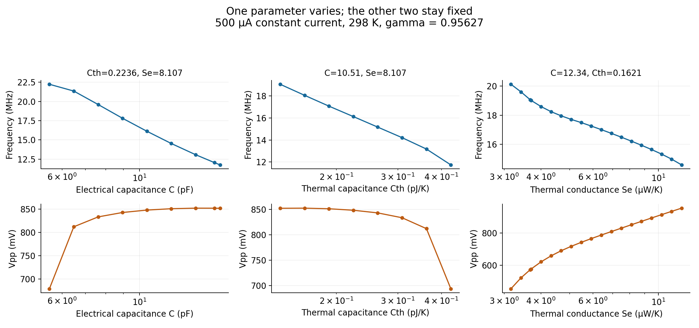
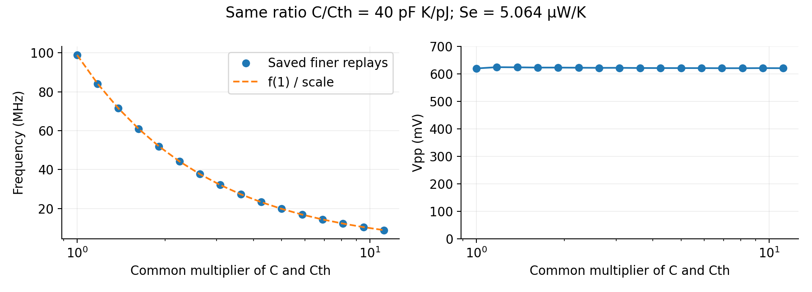

# Reading the full parameter exploration — 20 October 2026

The presentation was restored to its previous 19 slides at Gabriel's request.
The optimizer follow-up remains archived as evidence but is no longer included
in the deck. No old numerical bundle was changed or deleted.

[Full fixed-scale explorer with 1,258 GIFs](../public_jobs/20261007_123036_fixed-scale-viewer-portable-screened-parameter-m_4325d1/parameter_maps.html).
The HTML depends on its original `eaf6ab` media folder. The browser automation
policy blocks local HTML, so no successful automated browser opening or
end-to-end GIF interaction is claimed here. Local media files were verified.

[Reviewed saved-data analysis](../public_jobs/20261020_202706_saved-full-parameter-exploration-trends_cf3c76/report.md)
contains the source hashes, exact analysis script, every matched-neighbor pair,
1% and 5% change-bin summaries, nine representative parameter points, and three
unaltered C-sweep GIF/PNG examples. No simulation was rerun.

## Useful tendencies

At fixed 500 µA, 298 K and gamma=0.956269682, both increasing electrical C and
increasing thermal Cth lower frequency in the retained region. Increasing C
usually raises Vpp or approaches a plateau; increasing Cth usually lowers Vpp
or leaves it nearly unchanged. Increasing Se mostly lowers frequency and raises
Vpp, with exceptions and many small changes. The six-panel figure holds the
other two parameters fixed in each column; its fixed-value titles use pF,
pJ/K and µW/K. Source screens used a padded temperature interval and 110 MHz
operating ceiling; this is not a measured specimen calibration.

There are 965 adjacent C pairs, 947 adjacent Cth pairs and 1,113 adjacent Se
pairs with both endpoints eligible/converged in the finer GIF replays. These
comparisons never bridge an excluded grid position. Fine replay checks retain
1,256 of the original 1,258 points; 1,174 pass visual-resolution checks. The 1%
bins are descriptive, not accuracy claims: convergence tolerance was 5%.

The strongest structural result is the common-capacitance scale direction:
(C,Cth) -> (sC,sCth) preserves the deterministic constant-current path and Vpp,
while f -> f/s. Along a grid-aligned ratio-40 ray with Se=5.064 µW/K, 16 saved
independent integrations follow inverse frequency scaling within 0.198%; Vpp
ranges over 0.742% of the first point's value.

This suggests using amplitude/loop shape to examine capacitance ratio and Se,
then frequency to adjust the common scale. Gamma and ambient must be stated;
this is not a proof that all parameters are identifiable. The map's 298 K
conditions differ from the adopted 314.4 K experimental replay. A new
matched-condition ratio/Se map, with gamma explicit, is proposed but not run.

Blank cells are excluded/unresolved results, not physical nonoscillation bounds.
The [later adaptive boundary exploration](BOUNDARY_SEARCH.md) is the authority
for open scales and unresolved/calibration-censored edges. Software check: 186
existing tests passed and repository validation passed.

## Fresh experimental verification

The saved-data tendencies were subsequently tested using new integrations:
[fresh checks, qualified conclusions and exceptions](FRESH_PARAMETER_TRENDS_20261020.md).
The capacitance amplitude claims are weaker than the raw saved-grid signs:
three of five usable fresh changes per capacitance are below the numerical
resolution rule. Common scaling and the original-condition frequency directions
are supported; transfer to lower current/warmer ambient is not established.
